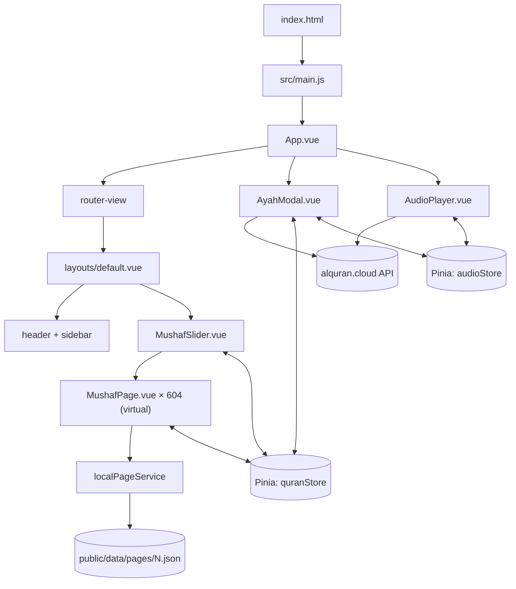
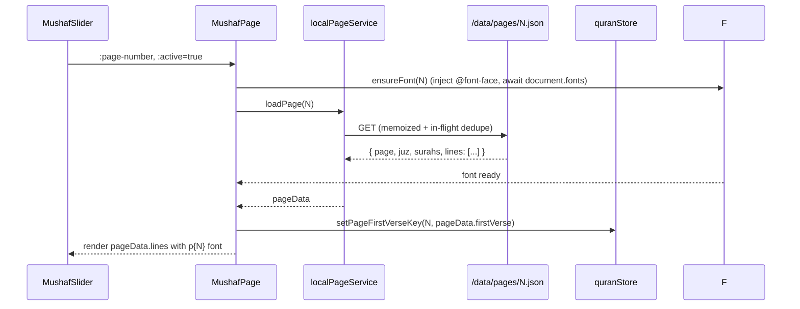
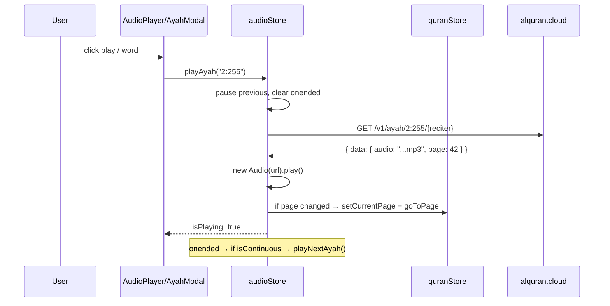

# Architecture

> How the app is wired end-to-end. Companion to [FILES.md](./FILES.md) (per-file) and [API_AND_DATA.md](./API_AND_DATA.md) (data).

---

## 1. High-level map



Key idea: **`App.vue` is the only place global overlays mount** (`AyahModal`, `AudioPlayer`), so they persist across page swipes.

---

## 2. Boot sequence

1. **`index.html`** runs an inline script *before* Vue mounts: reads `localStorage["quran_app_data_v2"]`, and if `settings.theme === "dark"` adds `.dark` to `<html>` (prevents theme flash). It also declares global `@font-face`s (`surah-name`, `othmani`, `thuluth`).
2. **`src/main.js`** creates the app, installs Pinia and the router, mounts `#app`.
3. **`src/App.vue`** renders `<router-view />` plus the two global overlays. On mount it re-applies the persisted theme class (idempotent).
4. **Router** matches `/` → `layouts/default.vue` (the shell).
5. **`layouts/default.vue`** builds the header, collapsible sidebar (Surahs / Juz / Bookmarks tabs), and mounts `<MushafSlider />` in the main area.

> ⚠️ **Routing reality:** `default.vue` contains **no `<router-view>`**, so its child routes (`HomeView`, `SurahView`, `BookmarksView`) are never rendered. The app is effectively a single-screen Mushaf reader. See [ISSUES.md](./ISSUES.md#5-routing-is-dead).

---

## 3. The rendering pipeline (core of the app)

This is the most important part to understand.

### 3.1 Slider → pages

`MushafSlider.vue`

- Renders a `Swiper` with **604 slides** (`v-for="(page, index) in 604"`).
- Responsive: 1 page below `1200px`, **2 pages** (`slidesPerView: 2`, `slidesPerGroup: 2`) at `≥1200px`.
- `rtl: true` so swiping mirrors Arabic reading order.
- Registers the Swiper instance in `quranStore` via `store.setSwiper()`.
- On `slide-change`, writes `store.setCurrentPage(activeIndex + 1)`.
- `isActive(page)` decides which pages are allowed to render content:
  - mobile: `currentPage - 1 … currentPage + 1`
  - desktop: `currentPage - 3 … currentPage + 3`
- The `Virtual` module is *imported and passed to Swiper*, but slides are still produced by `v-for`, so virtualization is **not actually active**. Rendering is limited only by `MushafPage`'s `v-if="isActive || isPreloaded"`.

### 3.2 Page → precomputed lines

`MushafPage.vue` (props: `pageNumber`, `active`)



**Step-by-step:**

1. **Font loading** — `fontService.ensureFont(N)` appends a `<style id="font-p{N}">` with
   `@font-face { font-family: 'p{N}-v1'; src: url('/fonts/p{N}.woff2'); font-display: block }`
   and the rule `.p{N}-v1 { font-family: 'p{N}-v1' }`, then waits for
   `document.fonts.load()` + `document.fonts.check()` to confirm the font can render.
   **The page is not painted until this resolves**: the glyphs are private-use codepoints,
   so rendering with a fallback font would show garbage symbols instead of Arabic.
   The page container gets classes `page_{N} p{N}-v1`.
2. **Load** — `localPageService.loadPage(N)` fetches the small local JSON
   (`public/data/pages/N.json`), caches it in memory, and dedupes concurrent requests.
   No network API call is needed for text.
3. **Store first verse** — `quranStore.setPageFirstVerseKey(N, pageData.firstVerse)` powers the "listen to page" button.
4. **Render** — `pageData.lines` is already ordered and typed (`words` / `basmalah` / `surah`),
   with per-line `center` flags. No runtime grouping or gap-filling.
5. **Words** — each word is a `<span>` with classes `word verse_{key}`; clicking sets
   `quranStore.selectedAyahKey`, which opens `AyahModal`. Highlighting is driven by
   `audioStore.currentAyahKey` (green glow) and `quranStore.selectedAyahKey` (amber underline).
6. **Hizb marker** — `pageData.hizbLine` / `pageData.hizbLabel` / `pageData.hizb` drive the marker.

**Font economics:** 604 page fonts × ~78 KB ≈ **46 MB**. They are *not* precached. The
service worker runtime-caches `/fonts/p*.woff2` with `CacheFirst` (1 year), so each font is
downloaded once on first view of its page and then works offline. `MushafSlider` warms the
next/previous page fonts after the swipe settles (±1), and only the visible pages (±1) load
fonts eagerly — a wide-screen view costs ~3 fonts (~230 KB), not 7.

Generation rules and schema: [PAGE_DATA_PIPELINE.md](./PAGE_DATA_PIPELINE.md).

### 3.3 Data shape (lean page)

```jsonc
{
  "page": 42,
  "juz": 3,
  "hizb": 5,
  "rub": 17,
  "surahs": [2],
  "firstVerse": "2:253",
  "hizbLine": 1,
  "hizbLabel": "الحزب",
  "lines": [
    { "type": "words", "runs": [["2:253", ["ﭑ ﭒ", "ﭓ", "ﭔ"]]] },
    { "type": "basmalah" },
    { "type": "surah", "chapter": 3 }
  ]
}
```

`runs` are `[verseKey, [glyphText, …]]`; `glyphText` is the page-font text from the source
API's `word.text`. Full schema notes: [PAGE_DATA_PIPELINE.md](./PAGE_DATA_PIPELINE.md).

---

## 4. Audio pipeline

`audioStore.js` + `AudioPlayer.vue` + `AyahModal.vue`



- **Reciters** are hard-coded (6): Alafasy, Minshawi, Husary, Abdul Basit, Sudais, Hudhaify.
- **Continuous mode** (`isContinuous`, default `true`, persisted): on `ended`, computes the next `surah:ayah` from `chapters` totals, wraps to the next surah, and stops at `114:6`.
- **Prev/next** buttons use the same chapter metadata.
- **No seek bar / progress / duration**; **no request caching** (each ayah = one metadata fetch).

---

## 5. State management

Two active Pinia stores + two legacy stores.

### `quranStore` (active) — `src/stores/quranStore.js`
| State | Meaning | Persisted |
|-------|---------|-----------|
| `bookmarks[]` | Saved ayahs (`{verse_key, surah, ayah, text, translation}`) | ✅ |
| `currentSurah[]` | Chapter id(s) on the current page | ✅ |
| `currentPage` | 1–604 | ✅ |
| `lastRead` | Mirrors `currentPage` | ✅ |
| `settings` | `{ translation, fontSize, theme }` | ✅ |
| `selectedAyahKey` | Opens the modal | ❌ |
| `pageFirstVerseKeys{}` | Page → first verse key | ❌ |
| `swiperEl` | Live Swiper instance | ❌ |

Storage key: **`quran_app_data_v2`**. `saveToStorage()` is called by most setters.

### `audioStore` (active) — `src/stores/audioStore.js`
| State | Meaning | Persisted |
|-------|---------|-----------|
| `isPlaying`, `currentAyahKey`, `audioElement`, `loading` | Playback runtime | ❌ |
| `isContinuous` | Auto-advance | ✅ |
| `reciter` | Selected reciter id | ✅ |
| `reciters[]` | Static list | ❌ |

Storage key: **`quran_audio_data_v2`**.

### Legacy / unused
- `src/stores/bookmarks.js` — separate `quran-bookmarks` key; never imported.
- `src/stores/counter.js` — Vue starter leftover; never imported.

> **Persistence is manual**, even though `pinia-plugin-persistedstate` is installed. Do not assume plugin persistence.

---

## 6. Search flow

`SearchBar.vue` → `quranServices.search(query)` → `alquran.cloud/v1/search/{query}/all/ar.sahih`.

- Debounced **500 ms**, minimum **3 characters**.
- Maps `response.data.matches` → `{ key, text, surahName, ayahNumber, page }`.
- On click: `setCurrentPage(page)` + `goToPage(page)` + `setSelectedAyahKey(key)`.
- Click-outside is handled by a locally-defined `vClickOutside` directive.

> The mapping assumes the API returns `page` per match. If absent, navigation silently does nothing.

---

## 7. Theming

- Tailwind `darkMode: 'class'`; `ThemeToggle` toggles `settings.theme` and adds/removes `.dark` on `<html>`.
- Persisted in `quran_app_data_v2.settings.theme`.
- `index.html` inline script applies it pre-paint to avoid flash.
- Most components carry `dark:` variants.

---

## 8. PWA / offline

`vite.config.js` → `VitePWA({ registerType: 'autoUpdate', injectRegister: null, ... })`, registered
from `src/main.js` via `registerSW({ immediate: true })` so a slow third-party asset cannot delay
the service worker.

- **Precache** (`globPatterns`): `js, css, html, ico, png, svg, ttf, json` plus the two small
  header fonts (`sura_names.woff2`, `UthmanicHafs1Ver18.woff2`). This includes **all 604 page
  JSON files + manifest** → build reports **615 entries / ~1.77 MB**. The 604 page fonts are
  deliberately excluded (`globIgnores` also drops two unused KFGQPC `.ttf` files).
- **Runtime caching:**
  - `/fonts/p*.woff2` → `CacheFirst`, 604 entries, 1 year → each page font is fetched **once**,
    on first view of that page, and then works offline.
  - `api.alquran.cloud/v1/*` → `CacheFirst`, 500 entries, 30 days.
  - `cdn.islamic.network/quran/audio/*` → `CacheFirst`, 100 entries, 7 days.
- **Offline:** page text + app shell are precached; fonts are cached per page as they are read.
  A page you have opened before works fully offline. A page you have **never** opened needs one
  78 KB font download, so offline it shows a retry message. Audio/tafsir remain cache-on-first-use.
- **Missing icons:** manifest references `pwa-192x192.png`, `pwa-512x512.png`; `includeAssets` references `apple-touch-icon.png`, `masked-icon.svg`. None exist in `public/`.

---

## 9. Design decisions & trade-offs

| Decision | Benefit | Cost |
|----------|---------|------|
| One font per page | Pixel-faithful Madinah layout | 604 font files (~46 MB), loaded on demand and runtime-cached |
| Precomputed per-page JSON | No runtime grouping, instant render, offline-ready | ~1 MB generated data committed; regenerate on rule changes |
| Manual localStorage | Simple, explicit | Boilerplate; easy to forget a setter |
| Swiper over CSS scroll | Smooth RTL page flipping | 604 slide nodes; virtual module unused |
| Hand-maintained datasets | Full control, no runtime parse | Drift risk vs. `quran-json` package |
| Global overlays in `App.vue` | Persist across swipes | Modals/player independent of route |

---

## 10. What is NOT here

- No backend, auth, database, or analytics.
- No tests, linting, or type-checking.
- No i18n framework (Arabic strings are hard-coded; UI is RTL).
- No state hydration beyond localStorage.
